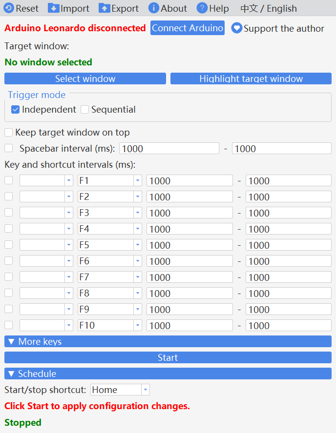

English | [简体中文](README.zh-CN.md)

# KeyPresser Hardware

KeyPresser Hardware is a Windows desktop app that uses an Arduino Leonardo as a USB keyboard. Configure keys, shortcuts and timing in the app. The Arduino sketch receives commands over USB serial and generates the keyboard input.

## Download for Windows

Get the x64 installer from [GitHub Releases](https://github.com/FinnWang-CN/KeyPresserHardware/releases/latest). The installer includes the Arduino sketch, also available in this repository.

## Build and set up

1. Install the **Qt 5.15.2 MSVC 64-bit** kit, including Qt Serial Port and the Qt Linguist tools, and install the MSVC C++ build tools.
2. Open [KeyPresserHardware.pro](KeyPresserHardware.pro) in Qt Creator, select the Desktop MSVC kit and build the application. The English translation is embedded during the build.
3. Connect an Arduino Leonardo via USB. Open [Arduino/keypresser.ino](Arduino/keypresser.ino) in the Arduino IDE. If prompted, let the IDE move the sketch into a folder named `keypresser`.
4. In **Tools → Board**, select **Arduino AVR Boards → Arduino Leonardo**. Select the board’s COM port under **Tools → Port** and upload the sketch.
5. Launch `KeyPresserHardware.exe`. The app looks for a Leonardo on startup. If it remains disconnected, click **Connect Arduino** and enter the COM port shown in the Arduino IDE or Windows Device Manager.

## Use the app

- Click **Support the author** beside **Connect Arduino** to open the WeChat support code.
- The startup tip for KeyPresser Professional shows at most once every seven days. Select **Do not show again** to turn it off.
- Click **中文 / English** in the toolbar to change the interface language. The app restarts and remembers the choice. On first launch it uses Simplified Chinese on Chinese Windows systems and English on other systems.
- Click **Select window**, then bring the target window to the foreground. Enable the keys you want, choose any modifiers, and set the interval in milliseconds. Use equal values for a fixed interval or different values for a random interval.
- Choose **Independent** to run each enabled key on its own timer, or **Sequential** to cycle through enabled key rows in order.
- Click **Start** to activate the target and begin sending keys. The app sends input only while the selected window is in the foreground. Return to KeyPresser Hardware and click **Stop** to end the run.
- Expand **Schedule** to configure a start and stop time. Use **Import** or **Export** to load or save a `.kphset` configuration.

## Troubleshooting

- If the board is missing, check the USB data cable and verify that the Leonardo appears under **Ports (COM & LPT)** in Device Manager.
- If the port is busy, close Arduino IDE’s Serial Monitor and try connecting again.
- If no keys arrive, verify that the sketch was uploaded, the correct window is selected and in the foreground, and at least one key is enabled.

## License

This project is licensed under [Creative Commons Attribution–NonCommercial–ShareAlike 4.0 International (CC BY-NC-SA 4.0)](LICENSE).
